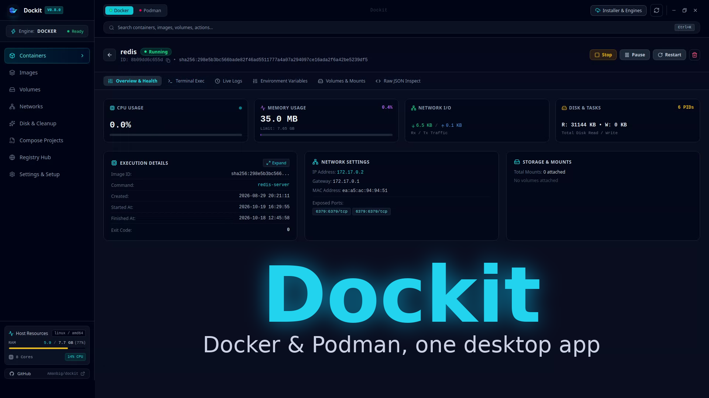

<p align="center">
  
</p>

<p align="center">
  A fast, cross-platform desktop app for managing <b>Docker</b> and <b>Podman</b>:
  containers, images, volumes, networks, Compose projects, and registries in one place.
</p>

<p align="center">
  <a href="https://github.com/Amanbig/dockit/releases/latest"></a>
  <a href="https://github.com/Amanbig/dockit/actions/workflows/ci.yml"></a>
  <a href="LICENSE"></a>
  <a href="https://github.com/Amanbig/dockit/issues"></a>
  
</p>

<p align="center">
  <a href="#install">Install</a> ·
  <a href="#features">Features</a> ·
  <a href="#getting-started">Build</a> ·
  <a href="CONTRIBUTING.md">Contribute</a> ·
  <a href="https://github.com/Amanbig/dockit/issues/new/choose">Report a bug</a>
</p>


  <p align="center"></p>

## Why Dockit?

Docker Desktop is heavy and tied to Docker. The CLI is powerful but hard to scan at a glance. Dockit gives you a lightweight native UI that works the same way with **Docker or Podman**, switchable at runtime, and can even install a container runtime for you if you don't have one.

Built with [Wails v2](https://wails.io) (Go) and React 19 + Tailwind CSS v4, so it ships as a small native binary instead of an Electron bundle.

## Features

- **Docker and Podman**: switch engines with one click. Dockit auto-detects Docker sockets, rootless and rootful Podman sockets, and Windows named pipes, and lets you override the endpoint.
- **Containers**: start, stop, restart, pause, delete (with batch actions), live CPU/memory/network/disk metrics, searchable log streaming, a full inspector, an interactive exec shell, and a create-container wizard (ports, env vars/`.env`, command override).
- **Images, volumes, networks**: list, pull, tag, inspect, create, batch delete, and prune.
- **Compose Studio**: open or clone projects, edit `docker-compose.yml` with syntax highlighting and snapshots, manage a `.env` tab, and run Up/Down/restart with live CLI output.
- **Registry Hub**: search Docker Hub and GitHub Container Registry, read rendered READMEs, browse tags, and pull in one click.
- **Reclaim Storage**: see disk usage by images, containers, volumes, and build cache, then quick-clean or prune selectively.
- **Host terminal drawer** (<kbd>Ctrl</kbd>+<kbd>`</kbd>): a VS Code-style terminal with persistent working directory, clipboard paste, and safe process-group cancellation.
- **Runtime installer**: detects a missing Docker or Podman and walks you through installing it (APT, DNF, Pacman, Homebrew, Winget, Chocolatey), explaining why elevation is needed.
- **Auto-update**: checks GitHub Releases and installs updates in place (`.deb`, `.rpm`, Windows installer, or portable binary).
- **Light and dark themes**, keyboard-friendly confirmation dialogs, and polling that pauses when the window is hidden or the engine is offline.

## Install

Download the latest build for your platform from the [Releases page](https://github.com/Amanbig/dockit/releases/latest):

| Platform | Packages |
| :--- | :--- |
| **Linux (amd64)** | `.deb`, `.rpm`, `.tar.gz` |
| **Windows (amd64)** | Installer `.exe`, portable `.zip` |
| **macOS (Universal)** | `.dmg`, `.zip` |

You need Docker or Podman for Dockit to manage, though it can install one for you. On Linux, Dockit needs GTK 3 and WebKitGTK 4.1 at runtime (installed automatically by the `.deb` and `.rpm` packages).

## Getting started

### Prerequisites

- [Go](https://go.dev/dl/) (version in [`go.mod`](go.mod))
- [Node.js](https://nodejs.org/) 20+ and npm
- [Wails CLI](https://wails.io/docs/gettingstarted/installation) v2.9+:
  `go install github.com/wailsapp/wails/v2/cmd/wails@latest`
- Docker or Podman, to try the app against a real engine
- **Linux only**, GTK and WebKit headers:

  ```bash
  # Debian / Ubuntu / Mint
  sudo apt-get install -y build-essential pkg-config libgtk-3-dev libwebkit2gtk-4.1-dev

  # Fedora / RHEL
  sudo dnf install -y gtk3-devel webkit2gtk4.1-devel
  ```

### Run in development

```bash
git clone https://github.com/Amanbig/dockit.git
cd dockit
(cd frontend && npm install)
wails dev -tags webkit2_41      # drop "-tags webkit2_41" on Windows/macOS or older WebKitGTK
```

### Production build

```bash
wails build -tags webkit2_41    # output: build/bin/dockit
```

### Tests

```bash
go test ./internal/...
```

## Project layout

```
dockit/
├── app.go, main.go        # Wails entrypoint and Go ↔ frontend bindings
├── internal/
│   ├── runtime/           # Docker/Podman abstraction (engine, docker, podman)
│   ├── containers/        # Container lifecycle and stats
│   ├── images/, volumes/, networks/
│   ├── compose/           # Compose parser, staging manager, CLI runner
│   ├── terminal/          # Host terminal and process-group management
│   ├── registry/          # Docker Hub and GHCR clients
│   ├── installer/         # Runtime detection and OS installers
│   ├── config/            # Preferences (atomic JSON)
│   ├── updater/           # GitHub release check and installer
│   └── version/           # Version constant
├── frontend/              # React + Tailwind CSS v4 UI
├── build/                 # Icons and packaging (Linux, Windows, macOS)
└── .github/               # CI, release workflow, issue/PR templates
```

## Contributing

Contributions of all sizes are welcome: bug reports, feature ideas, docs, and code.

1. Read [CONTRIBUTING.md](CONTRIBUTING.md) for the dev setup and PR process.
2. Look for issues labeled [`good first issue`](https://github.com/Amanbig/dockit/labels/good%20first%20issue) or [`help wanted`](https://github.com/Amanbig/dockit/labels/help%20wanted).
3. Please follow our [Code of Conduct](CODE_OF_CONDUCT.md).

Found a security problem? Don't open a public issue; see [SECURITY.md](SECURITY.md).

## Changelog

See [RELEASE_NOTES.md](RELEASE_NOTES.md) for the current release and [releases/](releases/) for the full history.

## License

Licensed under the [Apache License 2.0](LICENSE).
