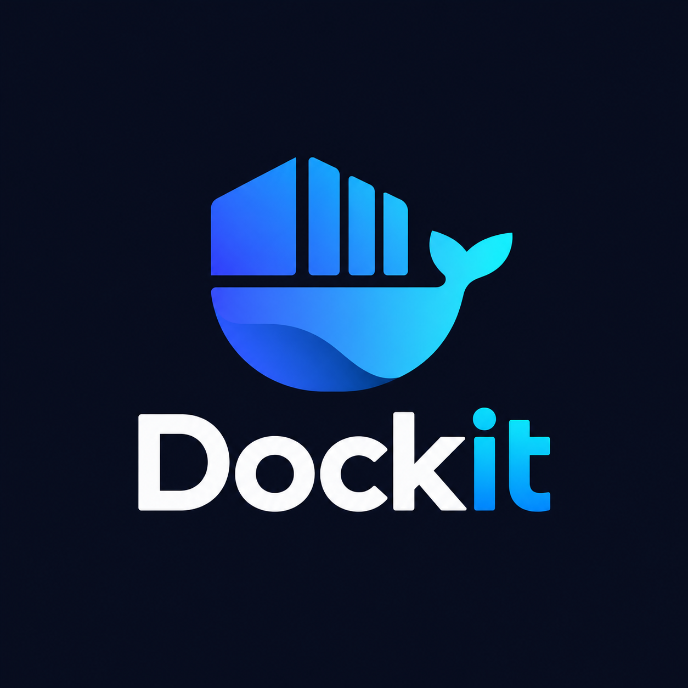

<p align="center">
  
</p>

# Dockit 🐳 🦭

> A modern, fast, cross-platform desktop container management application supporting **Docker** and **Podman** simultaneously with unified abstractions, staged Compose testing, multi-registry exploration, and built-in runtime detection & installation.

Built with **Go (Wails v2)** + **React 19** + **Tailwind CSS v4** + **Base UI / Shadcn**.

---

## ✨ Features

### 🔄 Unified Docker & Podman Engine Abstraction
- Seamlessly switch between **Docker** and **Podman** at runtime with a single click.
- Automatic detection of standard sockets, user rootless sockets (`/run/user/$UID/podman/podman.sock`), rootful sockets, and Windows named pipes (`//./pipe/docker_engine`).
- Custom socket endpoint overrides supported via persistent configuration.

### 📦 Containers Management & Interactive Terminal
- View, start, stop, restart, pause, unpause, and delete containers.
- **Multi-Select & Batch Actions**: Select multiple containers with row/master checkboxes to start, stop, restart, or delete multiple containers in 1 click with a consolidated confirmation prompt.
- Real-time container status badges, port bindings, and created timestamps.
- **Real-Time Resource Metrics**: Live CPU usage %, memory consumption (MB/GB) with limits, incoming/outgoing network I/O traffic, and block disk I/O / PIDs streamed directly on the overview tab.
- **In-Container Terminal Shell (Exec)**: Launch an interactive shell terminal (`/bin/sh`, `/bin/bash`) directly into running containers to run commands and inspect runtime state.
- **Log Streaming, Search Navigation & Highlighting**: Live container logs with auto-scroll to latest entries on open/stream, interactive Next/Previous match navigation arrows (<kbd>▲</kbd> / <kbd>▼</kbd> and <kbd>Enter</kbd> / <kbd>Shift+Enter</kbd>), dynamic active match highlighting with live match counters (`1/14`), toggleable full-context vs filtered line modes, and clipboard copy.
- **Inspect Inspector**: Deep JSON inspection of low-level container configurations and network settings.
- **Create Container Wizard**: Interactive dialog to spin up containers with port mappings, restart policies, network attachments, and a dedicated **Interactive Environment Variables Manager** supporting a visual key-value table, raw `.env` multi-line editing, and 1-click `.env` file uploading with live preview chips and overflow protection.

### 🖼️ Images & Local Cache
- List local images with repository tags, IDs, and human-readable sizes.
- **Batch Removal**: Select multiple images via checkboxes to delete them in a single batch with safety confirmations.
- Pull images from any public or private registry directly from the UI.
- Tag and inspect local image layers.
- Delete and prune unused images safely.

### 💾 Persistent Volumes & 🌐 Virtual Networks
- **Volumes**: Manage persistent storage volumes, inspect mount points, create new local volumes, batch-delete selected volumes via checkboxes, and prune dangling volumes.
- **Networks**: Inspect virtual bridges, host networks, overlays, and custom internal networks with IPAM subnet information.

### 🧹 Visual Disk Space & Prune Dashboard ("Reclaim Storage")
- **Storage Breakdown**: Visual breakdown of disk space consumed by Images, Containers, Volumes, and Build Cache with reclaimable percentage metrics.
- **1-Click Quick Clean**: Safely purges stopped container layers, dangling images, and build cache in a single tap without impacting running workloads.
- **Selective Prune**: Dedicated controls to prune specific categories (stopped containers, dangling images, unattached volumes, build cache, unused networks).
- **Accessible Dual-Theme Design**: Polished high-contrast views across both Dark Mode and Light Mode.

### 🛡️ Reliability & Notification Architecture
- **Floating Toast Notifications**: Non-blocking toast alerts (success, error, warning, info) with one-click error copying, replacing native browser alerts.
- **Human-Readable Engine Errors**: Context-aware formatting for common Docker and Podman daemon error codes.
- **Keyboard-Accessible Confirmation Dialogs**: Polished in-app modal confirmations (<kbd>Enter</kbd> / <kbd>Esc</kbd>) for all destructive operations.
- **React Error Boundaries**: Component-level isolation preventing white-screen crashes with instant 1-click view reloading.
- **Window Focus Auto-Sync**: Automatically refreshes container states and host metrics whenever the window regains focus.
- **Defensive Backend Timeouts**: 15-second bounded execution across Go RPC methods to prevent IPC hangs.

### 🧪 Docker Compose Studio & Workspace
- **Multi-Project Library**: Open folders containing `docker-compose.yml`, clone from Git URLs, or browse recent projects with persistent history.
- **Dedicated Project Workspace**:
  - **Visual Services Grid**: Context-aware Start, Stop, and Restart controls based on actual container running states.
  - **Compose Down Modal**: Choose cleanup options including volume removal (`--volumes`), orphan cleanup (`--remove-orphans`), and image deletion (`--rmi all`).
  - **YAML Testing Studio**: Edit compose configs with live syntax highlighting and non-destructive memory staging.
  - **Git-Style Blob Hashing (`sha256`) & Snapshots**: Authentic Git object ID hashing (`blob <length>\0<data>`) detects uncommitted edits and provides snapshot rollbacks.
  - **Live CLI Stream**: Real-time terminal output stream for Compose Up, Down, and service orchestration commands.

### 🌍 Unified Registry Hub
- Multi-registry exploration across **Docker Hub** and **GitHub Container Registry (GHCR)**.
- **Rich Markdown Documentation**: Full repository READMEs rendered in rich GitHub-flavored Markdown with code copy, formatted tables, and external documentation links opened via your default OS browser.
- **Tags & Architecture Browser**: Inspect tag layers, image sizes, and release dates with one-click pull commands.
- **Adaptive Number Formatting**: High-density star and pull counters (e.g. `1.14B+`, `34.8K`) with native hover tooltips showing exact counts.
- One-click image pulling and favorites bookmarking.

### 🎨 Themes & Adaptive UI
- Fully integrated **Dark Mode** and **Light Mode** with WCAG AA compliant contrast across all cards, modals, and tables.
- Responsive overflow protection with ellipsis truncation (`...`) and compact layouts for small displays and laptops.

### 🔄 In-Place Self-Updates & Release Management
- **Background Release Detection**: Automatic GitHub Releases checking with non-intrusive floating toast notifications and configurable startup toggles.
- **Native Package Detection & Root Elevation**: Automatically selects the native package format matching the installation (`.deb`, `.rpm`, `.exe`, `.tar.gz`) with PolicyKit (`pkexec`) authorization for system installs.
- **In-Memory Extraction & Atomic Replacement**: Downloads platform-matched binaries, unpacks in memory, and swaps the running executable in-place.
- **Instant Restart**: One-click **Restart Now** action respawns the updated binary seamlessly (VS Code-style UX).

### 🛠️ Runtime Detection & Engine Installer
- Cross-platform detection for Docker and Podman daemon states.
- Automated installation plans explaining prerequisites, package managers (APT, DNF, Pacman, Homebrew, Winget, Chocolatey), and privilege explanations (why `sudo` or admin is required).
- One-click trigger to install and configure container runtimes if not already present.

---

## 🏗️ Architecture

```
dockit/
├── app.go                      # Wails RPC backend bridge binding internal domains
├── main.go                     # Wails application entrypoint & window configuration
├── internal/
│   ├── runtime/                # Unified runtime abstraction
│   │   ├── runtime.go          # Runtime interface
│   │   ├── engine/             # Shared moby client implementation (containers, images, etc.)
│   │   ├── docker/             # Docker socket client connector
│   │   └── podman/             # Podman rootless/rootful socket auto-detector
│   ├── containers/             # Container lifecycle domain service
│   ├── images/                 # Image management domain service
│   ├── volumes/                # Volume domain service
│   ├── networks/               # Network domain service
│   ├── compose/                # Project parser, staged sandbox manager & CLI runner
│   ├── registry/               # Docker Hub & GHCR search/metadata clients
│   ├── config/                 # App local storage & user preferences manager (atomic JSON)
│   └── installer/              # Safe detection, authorization explanation, & OS installers
│       ├── linux/              # apt, dnf, pacman, zypper
│       ├── macos/              # brew, colima, docker desktop
│       └── windows/            # winget, choco
└── frontend/                   # React 19 + Tailwind v4 + Base UI
    ├── src/
    │   ├── components/         # Views: Containers, Images, Volumes, Networks, Compose, Registry, Settings, Modals
    │   ├── lib/utils.js        # Class merging utilities
    │   ├── App.jsx             # Main dashboard coordinator
    │   └── main.jsx
    └── wailsjs/                # Auto-generated RPC bindings between Go and JS
```

---

## 🚀 Getting Started

### Prerequisites
- **Go**: `1.22+`
- **Node.js**: `18+` & `npm`
- **Wails CLI**: `v2.9+` (`go install github.com/wailsapp/wails/v2/cmd/wails@latest`)
- Either **Docker** (`docker engine` or `docker desktop`) or **Podman** installed (or install them directly via Dockit's built-in installer!).

### Installation & Development

1. **Clone the repository**:
   ```bash
   git clone https://github.com/Amanbig/dockit.git
   cd dockit
   ```

2. **Install frontend dependencies**:
   ```bash
   cd frontend
   npm install
   cd ..
   ```

3. **Run in Live Development Mode**:
   ```bash
   wails dev
   ```
   > **Note for Linux (Ubuntu 24.04+, Linux Mint 22+, or WebKitGTK 4.1 users)**:  
   > If your distro uses `libwebkit2gtk-4.1-dev`, run with:  
   > ```bash
   > wails dev -tags webkit2_41
   > ```
   This spins up Vite with hot-reloading for the React UI and binds your Go methods in real time.

4. **Run Unit Tests**:
   ```bash
   go test ./...
   ```

---

## 📦 Production Build

To compile a self-contained desktop binary for your current operating system:

```bash
wails build
```

*(On Linux systems with WebKitGTK 4.1, use `wails build -tags webkit2_41`)*

The compiled binary will be placed inside the `build/bin/` directory.

### Target Platforms
- **Linux**: Standard binary / `.deb` / `.rpm`
- **macOS**: `.app` bundle / `.dmg`
- **Windows**: `.exe` executable / MSI installer

---
